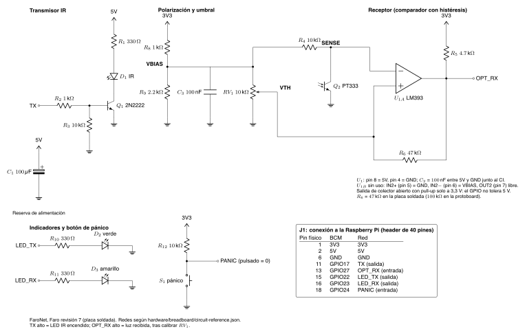

# Introducción

Hoy la amenaza a la privacidad no es solo que alguien lea un mensaje, sino
que registre **quién habla con quién, cuándo y desde dónde**: los metadatos.
FaroNet construye una red "desde el cobre hacia arriba" para estudiar ese
problema. Cada grupo arma un **Faro**, un dispositivo que transmite y recibe
datos por luz; sobre esos enlaces y sobre Ethernet/Wi-Fi funciona una **red
mesh anónima** en la que ningún nodo intermedio conoce a la vez el origen y
el destino de un mensaje; y los mensajes marcados explícitamente como
públicos salen, a través de una **puerta de enlace**, a una aplicación en el
**edge** (Cloudflare Workers) diseñada para aprender lo mínimo posible de sus
usuarios.

Estrategia acordada en el kick-off:

```text
[Nodo] --GPIO-- [Faro A] ~~~ infrarrojo ~~~ [Faro B] --GPIO-- [Gateway Pi]
   |                                                          |
   +-------- mesh anónima: sobres fijos de 492 B, onion -------+
                                                              |
                                            HTTPS/WebSocket (HMAC)
                                                              |
                                [Edge: salas públicas, feeds Atom]
```

1. **Capa física y de enlace propia** (Faro): OOK con codificación
   Manchester, tramas fijas de 128 bytes con CRC-32, ACK/reintentos y
   acceso al medio CSMA/CA, expuesta mediante la biblioteca
   `DispositivoLuzAdaptador`.
2. **Mesh** con directorio firmado, sobres de tamaño fijo y enrutamiento por
   capas (tres relevos) con criptografía reconocida (PyNaCl/libsodium).
3. **Edge público** en Rust/WebAssembly: salas por tema, feeds Atom,
   límite de peticiones y política de no registro.

El diseño completo está en el RFC del proyecto (anexo B). Este documento
explica las decisiones, el ambiente, las estructuras de datos, cómo
ejecutar todo y el estado final.

# Ambiente de desarrollo

## Software

| Herramienta | Versión | Uso |
| --- | --- | --- |
| macOS (Mac de desarrollo) | 26.6 | Desarrollo, pruebas, compilación del Worker |
| Python | 3.14.9 (Mac), 3.14.4 (Pi 3) | Faro, nodos, gateway, simuladores |
| `gpiod` (libgpiod v2) | 2.5.0 | GPIO del Faro en Linux |
| PyNaCl | 1.6.2 | Firmas Ed25519, cajas X25519 de la mesh |
| Rust / Cargo | 1.99.0 | Worker del edge (WebAssembly) |
| workers-rs / worker-build | 0.8.7 | Enlace Rust–Cloudflare Workers |
| Node.js / Wrangler | 22.13 / 4.149.0 | Desarrollo local, pruebas y despliegue del Worker |
| Ubuntu Server | 26.04.1 LTS (ARM64) | Sistema del Faro A (Raspberry Pi 3) |
| Raspberry Pi OS | por confirmar | Sistema del Faro B (Raspberry Pi 2) |
| PyCharm, RustRover | — | IDE de Python y de Rust |
| Git y GitHub | — | Control de versiones (monorepositorio) |
| pandoc, XeLaTeX, CircuiTikZ | 3.12, TeX Live 2025 | Documentación, PDF y esquemático |

## Hardware y herramientas

- Raspberry Pi 3 Model B (Faro A) y Raspberry Pi 2 Model B (Faro B), cada
  una con su microSD y fuente de 5 V / 2,5 A.
- Protoboard para el prototipo; perfboard azul de una cara (7 × 9 cm,
  parejas de dos agujeros y cuatro rieles) para la versión soldada.
- Multímetros: XL830L (con prueba de hFE), Truper y MY-64.
- Cautín, soldadura, pinzas y pelacables (propios o prestados).
- Cámara de un teléfono para ver la emisión infrarroja.

## Depuración

- **Simuladores sin hardware**: el enlace óptico completo (forma de onda
  Manchester, pérdidas, duplicados), un medio con colisiones para CSMA/CA y
  una mesh de laptops. Las pruebas del backend GPIO usan un `gpiod` falso.
- **Banco con multímetro**: continuidad y cortos sin energía, luego
  tensiones por etapa con la Pi encendida (sección 5.3).
- **Telemetría por SSH**: `gpio-calibrate` muestra cada medio segundo qué
  decide el comparador, para calibrar el trimpot sin ADC;
  `optical-loopback` valida tramas completas con el reflejo de la propia
  placa.
- **Worker local**: `wrangler dev --local` y una prueba de extremo a extremo
  con WebSockets; luego una prueba de humo contra el despliegue.

## Flujo de trabajo

Monorepositorio con `python/` (PyCharm) y `rust/` (RustRover). El dueño del
repositorio revisa y publica; las Pis se actualizan con
`git pull --ff-only` desde sus clones. Las decisiones se registran en
`docs/decisions.md`, los contratos en `docs/rfc/` y la bitácora de
implementación y pruebas en `MERGER.md`. Toda compilación del Worker ocurre
en la Mac; las Pis solo ejecutan Python.

# Diseño

## Arquitectura y roles

| Rol | Dónde corre | Lenguaje |
| --- | --- | --- |
| Faro (control GPIO, enlace óptico) | Cada Raspberry Pi | Python |
| Nodo de la mesh | Cada Pi y laptops adicionales | Python |
| Gateway | Una Pi (propuesta: la Pi 3, por su Wi-Fi) | Python |
| Edge | Cloudflare Workers, plan gratuito | Rust compilado a WebAssembly |

## Hardware del Faro

El Faro usa una Raspberry Pi como controlador y una placa con el emisor, el
receptor, dos indicadores y el botón de pánico. Decisiones principales:

- **Infrarrojo en vez de láser o LDR.** Se planificó un láser rojo, pero el
  enlace implementado es IR (940 nm) con fototransistor PT333, un par de
  espectro compatible. El LDR se descartó por lento.
- **Receptor digital con comparador e histéresis**
  (`docs/adr/0001-digital-optical-receiver.md`): la Pi no tiene ADC, así que
  un LM393 compara la tensión del fototransistor con un umbral ajustable
  (trimpot) y entrega un nivel digital a 3,3 V. La realimentación R6 da
  histéresis para evitar rebotes.
- **Seguridad eléctrica**: la salida del comparador es de colector abierto
  con pull-up **solo a 3,3 V**; ningún GPIO recibe 5 V.
- **Revisión 7 del montaje**: un Faro por protoboard, sin RGB, emisor y
  receptor en filas espejo para que dos Faros girados 180° queden
  alineados. Se generó y validó con un modelo (`validate_layout.py`).
- **Revisión 7a**: un segundo puente de GND (TG:21 a BG:21) tras encontrar
  contacto intermitente en los orificios del riel.
- **Placa soldada**: R6 baja de 100 kΩ a 47 kΩ para más histéresis, porque
  la telemetría mostró rebotes en una de las transiciones; R10 y R11 bajan a
  330 Ω. La colocación en la perfboard (`hardware/perfboard/`) también se
  generó desde un modelo de la placa y se valida contra la netlist: dos
  puentes de GND entre los rieles, un segundo GND de la Pi, jumpers hembra
  cortados y soldados, y D1 y Q2 a unos 4 cm en filas espejo del borde
  derecho, con funda negra para aislar el receptor del emisor propio.



El esquemático fuente está en `hardware/schematic/faro-rev7.tex`; la lista
de materiales con costos en colones está en `hardware/bom.md` (anexo A).

## Capa 1: protocolo físico y de enlace

- **Codificación**: OOK con Manchester (bit 0 = apagado/encendido,
  bit 1 = encendido/apagado), bit más significativo primero. El medio bit
  *T* es configurable de 2 a 20 ms.
- **Trama fija de 128 bytes**: preámbulo `55 55 55 55`, sincronía `D3 91`,
  versión, tipo (DATA/ACK), direcciones locales de 8 bytes, sesión de
  8 bytes, secuencia, longitud de carga (campo aparte), 86 bytes de carga y
  relleno, y CRC-32 sobre los bytes 6–123.
- **Adquisición**: cada transición se marca con la hora del kernel; tras
  8 *T* de oscuridad, el primer flanco de subida inicia una trama; se
  muestrea a la mitad de cada medio bit.
- **Confiabilidad**: parada y espera con ACK, tres intentos y plazo de
  ACK de 3 *F* (*F* = 2048 *T*); los duplicados se reconocen sin volver a
  entregarse.
- **Acceso al medio (CSMA/CA)**: el ACK sale tras una guarda de 16 *T*; los
  datos esperan 64 *T* de oscuridad más un retroceso aleatorio de ranuras
  de 32 *T*, con ventana 8, 16 y 32 según el intento. Nadie asigna turnos.
- **Versionado**: byte de versión en una posición fija.
- **Tramas externas**: `send_frame()` acepta una trama de 128 bytes
  construida fuera del Faro (por ejemplo con Scapy).

## Capas 2 y 3: mesh anónima

Diseño del Estudiante B (propuesta 0002); el transporte LAN y el chat los
implementó el Estudiante A para liberar al Estudiante B con el Faro B:

- Identidad por nodo: claves Ed25519 y X25519; el ID es SHA-256 de la clave
  de verificación, truncado a 16 bytes.
- Directorio de nodos con entradas firmadas y caducidad máxima de 30 días.
- Sobre fijo de 492 bytes, que viaja como 6 tramas de 86 bytes con
  cabecera de fragmento (etiqueta, índice, cuenta).
- Tres capas *onion* con *sealed box* más una capa de entrega con `Box`; el
  relevo re-rellena con bytes aleatorios para que todo sobre mida lo mismo.
- Mensaje privado de 190 bytes con versión, tipo, caducidad (TTL) y texto
  de hasta 178 bytes.
- Enlaces LAN: registros fijos de 493 bytes sobre TCP (un byte de tipo y un
  cuerpo de 492). Al conectar, cada extremo demuestra con su firma que
  posee la clave de la entrada de directorio que presenta.
- Las entradas de directorio y las listas firmadas de vecinos se propagan
  por inundación; cada nodo elige al azar una ruta de tres relevos sobre
  enlaces que ambos extremos confirman (enrutamiento de origen). Cada
  relevo espera entre 0 y 200 ms al azar antes de reenviar.
- Chat privado de terminal (`chat`) y nodos solo de relevo (`mesh-node`);
  cada ejecución genera una identidad nueva que nunca se guarda en disco.
- **Enlace óptico en la mesh en vivo** (RFC, sección 5.9): con
  `--faro-peer`, el nodo arranca `optical-bridge`, un proceso aparte que
  maneja el GPIO para que la temporización del Faro no espere al nodo. El
  nodo se conecta al puente por TCP local como a cualquier vecino LAN, así
  que el saludo, la propagación y el enrutamiento son los mismos. Por la
  luz, cada sobre viaja como sus 6 fragmentos de 86 bytes y los registros
  de control (públicos) sin su relleno, en trozos de hasta 85 bytes. Si un
  envío falla tras tres intentos, ambos Faros pasan a una sesión derivada
  nueva (época) y repiten el saludo sin intercambiar nada a mano.

## Privacidad y modelo de amenazas

| Adversario | Qué puede ver | Qué no puede ver |
| --- | --- | --- |
| Nodo malicioso (relevo) | Vecinos, sobres de 492 B, tiempos, su posición en la ruta | Las demás capas; origen y destino a la vez |
| Observador de la luz | Direcciones de enlace, sesión, secuencia, etiquetas, tiempos | Contenido de los sobres, extremos de la mesh |
| Operador del gateway | Mensajes públicos y su tráfico al edge | Mensajes privados y su origen |
| Proveedor del edge | IP de clientes, tiempos, mensajes públicos | Mensajes privados, nada dentro de la mesh |

Medidas: tamaños fijos (tramas, sobres, mensajes), cifrado de extremo a
extremo, enrutamiento por capas, TTL en mensajes y en el feed (24 h),
direcciones físicas aleatorias guardadas en disco y rotadas cada 24 h y al pulsar pánico,
botón de pánico y ninguna bitácora con IP o identificadores. Los límites
conocidos (colusión de relevos 1 y 3, análisis de tiempos, sin secreto
hacia adelante, borrado de memoria en Python solo de mejor esfuerzo) se
discuten en las secciones 10 y 11 del RFC.

## Capa 7: edge público

Desplegado en **<https://faronet-edge.faronet.workers.dev>**:

- **Salas por tema** con WebSockets, un Durable Object por tema; mensajes
  de hasta 1024 bytes, 16 conexiones y 5 mensajes por conexión cada 10 s.
- **Feed Atom por tema** en `/rooms/{tema}/feed.atom`: últimas 20 entradas
  por un máximo de 24 horas, hora redondeada al minuto, sin identidad; una
  alarma borra lo vencido.
- **Límite de peticiones**: 60 por cliente por minuto (salvo `/health`),
  con contador solo en memoria.
- **No registro**: logs, trazas y observabilidad desactivados; no se
  guardan encabezados como `CF-Connecting-IP`.
- **Relevo del gateway** (`POST /gateway/rooms/{tema}`): solo el gateway
  publica en las salas desde la mesh, con HMAC-SHA-256, marca de tiempo y
  nonce de un solo uso (Durable Object `GatewayReplay`, guarda solo nonce y
  caducidad). Sin `GATEWAY_SECRET` las rutas responden 404.
- **Buzón muerto** (`/gateway/drop/{id}`): una casilla de 1024 bytes
  opacos por identificador de 64 hex, se escribe una vez y se borra al
  leerla, con caducidad de 24 h. Los identificadores y el cifrado
  (SecretBox) salen de un secreto de 32 bytes que las dos personas
  comparten fuera de banda; el edge nunca ve el texto.
- **Réplica pública del directorio** (`POST /gateway/directory`,
  `GET /directory`): el edge verifica cada entrada firmada igual que un
  nodo (formato, ID derivado de la clave, caducidad de 30 días, Ed25519) y
  guarda hasta 256; quien la lee vuelve a verificar cada entrada.
- Todo texto que ve una persona usuaria (páginas, feeds, errores, chat y
  comandos) está en español; el código y sus comentarios, en inglés.

# Estructuras de datos y funciones principales

## Python: `faronet.dispositivo_luz_adaptador`

| Elemento | Descripción |
| --- | --- |
| `Frame` | Dataclass inmutable de la trama: tipo, origen, destino, sesión, secuencia y carga. `encode()` produce los 128 bytes con CRC; `decode()` valida todo; `acknowledgment()` e `is_ack_for()` construyen y comparan ACK. |
| `manchester.encode/decode` | Conversión entre bytes y niveles de luz por medio bit. |
| `PhysicalDispositivoLuzAdaptador` | La biblioteca exigida: `send()`, `send_frame()`, `receive()` y `clear()` sobre un enlace real, con reintentos y supresión de duplicados. |
| `CsmaLink` (`medium.py`) | Máquina de estados CSMA/CA sin hardware: `offer()`, `poll(ahora, idle_since, ocupado)` y `on_frame()` devuelven acciones (transmitir, entregado, resultado). |
| `SimulatedMedium` | Medio simulado de dos Faros en unidades de medio bit; la luz superpuesta pierde ambas tramas. |
| `SimulatedLink` | Simulador de turnos explícitos con fallas inyectadas (pérdida, corrupción, duplicado). |

## Python: `faronet.faro` (hardware)

| Elemento | Descripción |
| --- | --- |
| `EdgeDecoder` | Recupera tramas a partir de flancos con marca de tiempo; descarta ruido temprano tras revisar preámbulo y sincronía. |
| `GpioFrameIO` | Una única solicitud de líneas libgpiod: `transmit()` (con modo `loopback`), `receive()`, `guard()`, `channel()` (detección de portadora), `sample_rx()` y pánico latcheado. Al cerrar deja todas las salidas en bajo. |
| `run_link()` | Lazo que conecta un `CsmaLink` con el GPIO (`optical-link`). |
| `rx_telemetry()` | Telemetría de calibración del umbral (`gpio-calibrate`). |
| `profile.PINS` | Mapa BCM/pin físico verificado contra `circuit-reference.json`. |

## Python: `faronet.node` y `faronet.gateway`

| Elemento | Descripción |
| --- | --- |
| `Identity`, `DirectoryEntry`, `Directory` | Claves del nodo, entradas firmadas y directorio verificado. |
| `fragment()`, `Reassembler` | Divide un sobre en 6 cargas y lo rearma por vecino. |
| `build_envelope()`, `peel()`, `PrivateMessage`, `Route` | Construcción y apertura de capas onion y del mensaje privado. |
| `Node`, `MeshSimulation`, `OpticalLink`, `DirectLink` | Mesh simulada sobre enlaces directos y sobre el enlace óptico simulado. |
| `LanNode` (`lan.py`) | Nodo real sobre TCP: `listen()`, `dial()`, saludo con prueba de firma, propagación de entradas y vecinos, `routes_to()` y `send_text()`. |
| `LinksRecord`, `encode_record()`, `decode_record()` | Lista firmada de vecinos y registros LAN de tamaño fijo. |
| `ChatSession` (`chat.py`) | Comandos del chat de terminal: `/peers`, `/to`, `/ttl`, `/quit`; muestra los mensajes recibidos. |
| `gateway.auth` | Firma y verificación HMAC con frescura y admisión de nonce. |
| `EdgeClient` (`gateway/client.py`) | Cliente firmado del edge: `publish()`, `drop_put()`, `drop_take()`, `publish_entry()`; envía su propio User-Agent porque Cloudflare rechaza el de `urllib`. |
| `seal_drop()`, `open_drop()`, `drop_slot_id()`, `fetch_directory()` | Buzón cifrado a 1024 bytes exactos con identificadores derivados del secreto compartido; lectura y verificación de la réplica del directorio. |
| `serve_bridge()`, `WireDecoder`, `epoch_session()` (`faro/bridge.py`) | Puente entre un nodo (TCP local) y el `CsmaLink` del Faro: fragmentos para sobres, flujo de control sin relleno y cambio de época tras una falla. |
| `AddressStore` (`faro/address.py`) | Dirección física aleatoria de 8 bytes en un archivo privado; rota cada 24 h y al pulsar pánico. |

## Rust: `rust/src`

| Elemento | Descripción |
| --- | --- |
| `PublicRoom` | Durable Object por tema: retransmite mensajes, guarda el feed y programa la alarma de TTL. |
| `atom_feed()`, `prune_feed()`, `append_feed()`, `rfc3339()`, `xml_text()` | Feed Atom puro y probado: TTL, límite de 20 entradas, fechas y escape XML. |
| `EdgeLimiter`, `admit_in_window()`, `limiter_key()` | Límite de peticiones por cliente, en memoria. |
| `gateway_auth` | Contrato HMAC compartido con Python mediante vectores en `fixtures/`. |
| `gateway.rs`: `route()`, `valid_body()`, `GatewayReplay`, `DeadDrop` | Rutas del gateway, validación del cuerpo antes de reclamar el nonce, anti-reenvío y buzón muerto en Durable Objects SQLite. |
| `directory.rs`: `verify_entry()`, `decide()`, `DirectoryReplica` | Verificación Ed25519 de entradas del directorio, regla más nueva gana y réplica con alarma que borra lo vencido. |

El código fuente está documentado con docstrings y comentarios en cada
módulo; cada carpeta tiene su `README.md`.

# Instrucciones para ejecutar

## Mac: Python y simulaciones

```bash
cd python
python3 -m venv .venv
.venv/bin/python -m pip install -r requirements.txt
.venv/bin/python -m unittest discover -s tests -q
.venv/bin/python -m faronet simulate
.venv/bin/python -m faronet mesh-demo
```

## Preparar cada Faro ("flashear")

El Faro es una Raspberry Pi: se graba la imagen del sistema (Ubuntu Server
con balenaEtcher en la Pi 3; Raspberry Pi OS con Raspberry Pi Imager en la
Pi 2), se clona el repositorio y se instala el entorno:

```bash
cd ~/FaroNet && git pull --ff-only origin main
cd python && python3 -m venv .venv
.venv/bin/python -m pip install -r requirements-gpio.txt
sudo .venv/bin/python -m faronet gpio-preflight
```

## Comandos del Faro (en la Pi, desde `python/`)

```bash
sudo .venv/bin/python -m faronet gpio-monitor --hardware-ready --seconds 20
sudo .venv/bin/python -m faronet gpio-calibrate --hardware-ready --blink
sudo .venv/bin/python -m faronet optical-loopback --hardware-ready --count 10 --half-bit-ms 2
```

Enlace entre dos Faros, sin roles: cada Faro muestra su dirección física
(aleatoria, guardada en disco, rota cada 24 h y al pulsar pánico) y la
intercambian; ambos usan la misma sesión nueva:

```bash
sudo .venv/bin/python -m faronet optical-address
SESSION=$(.venv/bin/python -m faronet optical-session)
sudo .venv/bin/python -m faronet optical-link --hardware-ready \
  --peer DIRECCION_DEL_OTRO_FARO --session "$SESSION" --count 3 --half-bit-ms 10
```

La guía completa de puesta en marcha y medición está en
`docs/optical-bringup.md`; el montaje paso a paso, en
`hardware/breadboard/faronet-breadboard-review.html`.

## Mesh y chat privado en la LAN (Pis y laptops, desde `python/`)

Cada máquina corre un nodo; una ruta necesita al menos cinco nodos (quien
envía, tres relevos y quien recibe), así que una laptop puede correr
varios en puertos distintos. Cada `--peer` crea un enlace; basta
declararlo en uno de los dos extremos.

```bash
.venv/bin/python -m faronet chat --alias alice --listen 0.0.0.0:7400
.venv/bin/python -m faronet mesh-node --alias r1 --listen 0.0.0.0:7401 --peer IP_ALICE:7400
.venv/bin/python -m faronet mesh-node --alias r2 --listen 0.0.0.0:7402 --peer IP_R1:7401
.venv/bin/python -m faronet mesh-node --alias r3 --listen 0.0.0.0:7403 --peer IP_R2:7402
.venv/bin/python -m faronet chat --alias bob --peer IP_R3:7403 --to alice
```

En el chat, `/peers` lista los nodos conocidos y si hay ruta hacia ellos;
`/to NOMBRE` elige el destino y cualquier otra línea se envía. Cada
mensaje enviado muestra los tres relevos usados. `/panic` (o el botón del
Faro con `--panic-gpio /dev/gpiochip0`) borra llaves, enlaces y mensajes,
limpia la pantalla y sale. `/tema TEMA A,B` abre un tema privado: cada
línea va cifrada a cada miembro y nunca sale de la mesh. `/publico TEMA
TEXTO` manda texto público al gateway (por defecto el alias `gateway`, o el
que elija `/gateway NOMBRE`); un `mesh-node --edge-publish` lo publica en la
sala y el feed de ese tema. Para una trama creada fuera del Faro:
`sudo .venv/bin/python -m faronet optical-inject --hardware-ready --frame HEX`.

## Mesh por luz entre dos Faros (en cada Pi, desde `python/`)

Cada Faro muestra su dirección física y comparten una sesión; luego cada
Pi corre su nodo con `--faro-peer` (con `sudo`, porque usa el GPIO). El
enlace por luz sustituye al `--peer` entre esos dos nodos; no conviene
enlazar el mismo par por LAN y por luz a la vez.

```bash
sudo .venv/bin/python -m faronet optical-address
SESSION=$(.venv/bin/python -m faronet optical-session)   # en un Faro; copiarla al otro
sudo .venv/bin/python -m faronet mesh-node --alias r1 --listen 0.0.0.0:7401 \
  --faro-peer DIRECCION_DEL_OTRO_FARO --faro-session "$SESSION" --half-bit-ms 2
```

El otro Faro corre lo mismo con su propio alias y la dirección del
primero; los demás nodos se enlazan por LAN como antes. A *T* = 2 ms cada
trama tarda 4,1 s: el saludo por luz toma alrededor de un minuto,
sincronizar el directorio de una mesh de cinco nodos unos 7 minutos y
cada sobre cerca de 52 s por salto óptico. Los sobres esperan detrás de
la sincronización, así que conviene enviar cuando `/peers` ya muestre ruta
y subir la vida del mensaje (`--ttl 3600` o `/ttl 3600`; por defecto
300 s). El botón de pánico del Faro
detiene el puente y borra el nodo; Ctrl+C detiene ambos y apaga las
salidas.

## Gateway y edge desde la Pi del gateway (desde `python/`, sin `sudo`)

```bash
.venv/bin/python -m faronet gateway-secret          # se escribe oculto, una vez
.venv/bin/python -m faronet gateway-publish --topic demo --text "hola desde FaroNet"
.venv/bin/python -m faronet mesh-node --alias gw --listen 0.0.0.0:7404 --edge-publish
.venv/bin/python -m faronet directory-fetch        # desde cualquier máquina
```

Buzón muerto: una persona corre `drop-secret` y comparte ese secreto de
32 bytes fuera de banda; cada una lo carga en la variable
`FARONET_DROP_SECRET` sin que quede en el historial (`read -s`) y acuerdan
un número de casilla:

```bash
read -s FARONET_DROP_SECRET && export FARONET_DROP_SECRET
.venv/bin/python -m faronet drop-put --slot 1 --text "nos vemos a las 3"
.venv/bin/python -m faronet drop-take --slot 1
```

## Edge (en la Mac, desde `rust/`)

```bash
npm ci && npm run setup
cargo test --locked && npm run check && npm run build
npm run dev:rooms        # local, en http://127.0.0.1:8787
npm run test:rooms       # en otra terminal
npm run dev:gateway      # local con un secreto de prueba, reiniciado
npm run test:gateway     # en otra terminal
npx wrangler login
npx wrangler secret put GATEWAY_SECRET   # una vez, se escribe oculto
npm run deploy
npm run smoke -- https://faronet-edge.faronet.workers.dev
```

## Documentación

```bash
python3 scripts/build_docs.py
```

Genera `output/FaroNet-documentacion.pdf` con este documento, la BOM y el
RFC.

# Actividades realizadas por estudiante

Resumen tipo bitácora. Las horas las aporta cada estudiante; las fechas y
actividades se tomaron del historial de Git y de `MERGER.md`.

## Estudiante A (AleQuesada2012)

| Fecha | Actividad | Horas |
| --- | --- | ---: |
| 2026-10-01 | Estructura inicial del proyecto (Python, Rust, documentación) | 2 hrs |
| 2026-10-09 | Hito 1: códec óptico, simulador y autenticación del gateway | 5 hrs|
| 2026-10-22 | Especificación de hardware y decisiones finales | 4 hrs |
| 2026-10-25 | Adaptador óptico GPIO, salas públicas locales, perfiles de protoboard | 2 hrs |
| 2026-10-26 a 30 | Montaje y pruebas del Faro A en protoboard (transistor, LED IR) | 35 hrs |
| 2026-10-31 | Encendido, diagnóstico (GND, alimentación del LM393), revisión 7a | 3 hrs |
| 2026-10-31 | Calibración, loopback, corrección de huecos de secuencia, CSMA/CA, temporización | 6 hrs |
| 2026-10-31 | Edge: feeds Atom, límite de peticiones y despliegue | 1 hr |
| 2026-10-31 a 11-01 | RFC unificado, BOM, esquemático y documentación | 4 hrs |
| 2026-11-01 | Diagnóstico de temporización TX (loopback a 2, 3 y 5 ms) | 1 hr|
| | **Total** | 63 |

## Estudiante B (An-Gi)

| Fecha | Actividad | Horas |
| --- | --- | ---: |
| 2026-10-01 | Estructura inicial del proyecto (Python, Rust, documentación) | 2 hrs |
| 2026-10-22 | Mesh: identidades, directorio firmado, sobres onion, fragmentación, simulación (propuesta 0002) | 5 hrs |
| 2026-10-26 a 30 | Montaje y pruebas del Faro B en protoboard (transistor, LED IR) | 35 hrs |
| 2026-10-31 | Encendido, diagnóstico (GND, alimentación del LM393), revisión 7a | 3 hrs |
| 2026-10-31 | Calibración, loopback, corrección de huecos de secuencia, CSMA/CA, temporización | 10 hrs |
| 2026-10-31 | Edge: feeds Atom, límite de peticiones y despliegue | 1 hr |
| 2026-10-30 | Rediseño del montaje como revisión 7, sin RGB | 4hrs |
| 2026-10-31 a 11-01 | RFC unificado, BOM, esquemático y documentación | 4 hrs |
| 2026-11-01 | Diagnóstico de temporización TX (loopback a 2, 3 y 5 ms) | 1 hr |
| 2026-11-01 | Montaje y pruebas del Faro B | 2 hrs |
| | **Total** | 66 |

# Autoevaluación

## Estado final

| Componente | Estado |
| --- | --- |
| Trama, Manchester, CRC, simuladores | Completo y probado (167 pruebas de Python y 31 de Rust en total) |
| Faro A en protoboard | Funciona: transmisión, recepción calibrada, pánico; *loopback* de 10/10 tramas sin errores a *T* = 5, 3 y 2 ms (2 ms: 20,7 B/s de carga útil) |
| CSMA/CA y `optical-link` | Implementado y probado en simulación; falta la prueba entre dos Faros |
| Faro B en protoboard | Funciona: transmisión, recepción calibrada; *loopback* de 10/10 tramas sin errores a *T* = 10, 3 y 2 ms (2 ms: 20,7 B/s de carga útil); a 5 ms, 8/10 con luz de la red eléctrica (parpadeo de 120 Hz) y 10/10 con la luz apagada. Ubuntu 22.04.5, Python 3.11.18; 160 pruebas pasaron en la Pi 2 |
| Medición de tasa y BER a tres distancias | **No realizada**: no se logró correr el enlace entre dos Faros antes de la entrega. Las herramientas están listas (`optical-link` y `optical-loopback`, que ahora reporta la BER cruda `ber` contando también las tramas dañadas); procedimiento en «Mediciones entre dos Faros» |
| Placa soldada, fotos y bitácora de multímetro | Plano de perfboard validado y guía de soldadura listos; bitácora en `hardware/bitacora-multimetro.md` con las mediciones de la protoboard del Faro B y la hoja para la perfboard; falta soldar, fotos y llenar esa hoja |
| Mesh, directorio, sobres onion | Implementado; enlaces LAN sobre TCP probados con cinco nodos en la Mac y entre la Pi del Faro A y la Mac (tres relevos en la Mac); falta repartir los relevos en más máquinas |
| Capa 7 anónima: chat de terminal | Implementado (`chat`, `mesh-node`), en español; mensaje y respuesta por tres relevos entre la Pi del Faro A y la Mac, sin rechazos. Temas privados (`/tema`, cifrados a cada miembro, nunca salen de la mesh) y texto público (`/publico`) que el gateway publica en la sala y el feed del tema; probado con cinco nodos y un Worker local |
| Enlace óptico como enlace de la mesh en vivo | Implementado (`optical-bridge`, `--faro-peer`); probado con dos puentes sobre una luz simulada entre nodos reales (mensaje y respuesta, recuperación tras una falla) y como procesos separados en la Mac con UDP en lugar de luz; falta correrlo entre dos Faros |
| Botón de pánico | Detiene el Faro, parpadea los LEDs verde y amarillo tres veces con el IR apagado, libera el GPIO, descarta la sesión y rota la dirección; en el chat, `/panic` o `--panic-gpio` borran llaves, enlaces, directorio y mensajes (mejor esfuerzo en Python). El parpadeo solo se probó con GPIO simulado |
| Rotación de direcciones físicas | Implementada (`optical-address`): aleatoria, en disco, cada 24 h y al pulsar pánico; la rotación por tiempo ocurre al iniciar un comando óptico, no durante una ejecución. La entrada de directorio de un nodo se vuelve a firmar cada 12 h, así que no hace falta reiniciarlo |
| Edge: salas, feeds, límite, no registro | Desplegado y verificado con prueba de humo |
| Edge: relevo del gateway y buzón muerto | Desplegado con el secreto del gateway; publicación, depósito y lectura del buzón probados desde la Pi del gateway contra el edge en vivo |
| Edge: réplica pública del directorio | Desplegada: el edge verifica cada entrada firmada (Ed25519) y la sirve en `/directory`; la entrada publicada por el nodo gateway desde la Pi se leyó y verificó desde la Mac |
| Tramas creadas fuera del Faro | `optical-inject --frame HEX` valida una trama de 128 bytes (por ejemplo hecha con Scapy) y la transmite sin cambios; probado con GPIO simulado |
| RFC, BOM, esquemático | Completos |

## Mediciones entre dos Faros

Por cada distancia, ambos Faros corren a la vez el mismo comando (cada uno
con la dirección del otro y una sesión nueva compartida):

```bash
sudo .venv/bin/python -m faronet optical-link --hardware-ready \
  --peer DIRECCION_DEL_OTRO_FARO --session "$SESSION" --count 10 --half-bit-ms 2
```

El resumen JSON final de cada Faro da los valores de la tabla: tasa de
carga útil (`payload_bytes_per_second`), tramas perdidas (`ack_timeouts`
entre `attempts_total`) y errores de bit en tramas que pasaron el CRC
(`payload_bit_errors`). Como el CRC descarta las tramas dañadas, la BER
de bits entregados será 0; la pérdida de tramas es la medida útil del
canal. Desde el 1 de noviembre, `optical-loopback` también da la BER cruda
(`ber`), que compara bit a bit las tramas dañadas con las enviadas.

**Estas mediciones no se realizaron**: los dos Faros no llegaron a
enlazarse por luz ya que el día que se iban a hacer las pruebas existieron varios contratiempos por fallos en el circuito. La tabla queda como procedimiento para hacerlas.

| Distancia (cm) | *T* (ms) | Faro | Tramas enviadas / confirmadas / recibidas | Intentos / sin ACK | Errores de bit | Carga útil (B/s) |
| ---: | ---: | --- | --- | --- | ---: | ---: |
| *(no medido)* | | A | | | | |
| *(no medido)* | | B | | | | |
| *(no medido)* | | A | | | | |
| *(no medido)* | | B | | | | |
| *(no medido)* | | A | | | | |
| *(no medido)* | | B | | | | |

## Problemas encontrados y limitaciones

- **Numeración invertida** de la mitad F–J de la protoboard del equipo:
  obligó a ubicar esos orificios por referencias físicas (revisión 7).
- **Conexiones faltantes** (W16, tierra del LM393; W20, histéresis) y un
  **contacto intermitente** en el riel de GND: el comparador quedaba sin
  tierra ni alimentación y el receptor nunca cambiaba de estado.
- **Huecos en la secuencia de eventos del kernel**: el decodificador
  descartaba tramas por fallas rápidas fusionadas por Linux; se corrigió
  validando con Manchester y CRC en lugar de descartar.
- **Temporización de transmisión**: a medio bit de 5 ms o menos el sistema
  no cumplía el margen de 0,4 *T*. Se agregó espera activa y prioridad de
  tiempo real, pero el error siguió. Un reporte de temporización por símbolo
  (`--timing-report`) mostró que solo el primer símbolo llegaba tarde: la
  Pi 3 tardaba unos 2,5 ms en codificar la trama después de fijar el primer
  plazo. Codificar antes de ese plazo bajó el retraso máximo de 2,4 ms a
  unos 0,2 ms.
- **Orientación del 2N2222**: el probador de transistores mostró que el
  del equipo es E-B-C visto desde la cara plana, al revés del supuesto;
  la guía de soldadura se corrigió dos veces hasta comprobar en la pieza
  que la cara plana va hacia la derecha.
- **Cloudflare rechazaba al cliente de Python** con 403 (error 1010) por
  el User-Agent por defecto de `urllib`, antes de llegar al Worker; el
  cliente ahora se identifica como `FaroNet-Gateway/<versión>`.
- El borrado de llaves en memoria con Python es de mejor esfuerzo.
- **No se midieron** la tasa efectiva ni la BER a tres distancias entre dos
  Faros, ni se corrió el enlace óptico de la mesh entre Faros reales.
- Los registros LAN no llevan byte de versión propio (la trama óptica, el
  mensaje y las entradas firmadas sí la llevan); agregarlo cambia su tamaño
  fijo de 493 bytes.
- El gateway sabe qué nodo envió cada mensaje público; el edge no.

## Reporte de commits

| Commit | Autor | Fecha | Descripción |
| --- | --- | --- | --- |
| c16c6d8 | AleQuesada2012 | 2026-10-01 | Create initial project scaffold |
| 7a981df | AleQuesada2012 | 2026-10-09 | Add initial milestone 1 implementation |
| d8eb527 | AleQuesada2012 | 2026-10-22 | Add hardware design specs and final decisions |
| a6518cf | An-Gi | 2026-10-22 | Basic implementation for sending messages |
| de0ccc4 | AleQuesada2012 | 2026-10-25 | Add Student A optical baseline and local public rooms |
| bc3d673 | AleQuesada2012 | 2026-10-25 | Support both basic and optional RGB breadboard profiles |
| e1007e0 | An-Gi | 2026-10-30 | Redesign breadboard as revision 7 and remove RGB |
| bb94c84 | AleQuesada2012 | 2026-10-31 | Add gpio-calibrate RV1 threshold telemetry command |
| 57c706c | AleQuesada2012 | 2026-10-31 | Record revision 7a ground bridge and receiver bench findings |
| e5ebaa3 | AleQuesada2012 | 2026-10-31 | Add optical-loopback single-board frame test |
| 29a0bb3 | AleQuesada2012 | 2026-10-31 | Keep optical captures across kernel event sequence gaps |
| 3a76443 | AleQuesada2012 | 2026-10-31 | Add CSMA/CA medium access and the optical-link command |
| 7992103 | AleQuesada2012 | 2026-10-31 | Tighten optical TX timing with spin-wait and real-time priority |
| 2e16426 | AleQuesada2012 | 2026-10-31 | Add Atom topic feeds and per-client rate limiting to the edge |
| 797c6c7 | AleQuesada2012 | 2026-10-31 | Prepare the edge Worker for deployment |
| 3e69b54 | AleQuesada2012 | 2026-10-31 | Record the public edge deployment URL |
| 4cbd035 | AleQuesada2012 | 2026-10-31 | Add the unified FaroNet RFC (FN-1) |
| e285e08 | AleQuesada2012 | 2026-10-31 | Add the Faro BOM with approximate costs in colones |
| 95b4338 | AleQuesada2012 | 2026-10-31 | Add the project documentation, its PDF build and the rev-7 schematic |
| cd95998 | AleQuesada2012 | 2026-10-31 | Add a TX timing report to optical-loopback |
| 08fc33b | AleQuesada2012 | 2026-10-31 | Encode each frame before its first TX deadline |
| 8afa8b7 | AleQuesada2012 | 2026-10-31 | Record 2, 3 and 5 ms loopback passes on Faro A |
| 5521917 | AleQuesada2012 | 2026-10-31 | Add LAN mesh links, the private terminal chat and relay nodes |
| 90639d0 | An-Gi | 2026-11-01 | Refuse a different directory entry with the same issue time at the edge |
| bbb1299 | An-Gi | 2026-11-01 | Re-sign a running node's directory entry every 12 hours |
| c17b4cd | An-Gi | 2026-11-01 | Send envelope fragments ahead of control chunks in the optical bridge |
| df8ed2f | An-Gi | 2026-11-01 | Share one link ID parser between the chat and the optical commands |
| 256fb58 | An-Gi | 2026-11-01 | Sync the gateway secret to disk before replacing the old file |
| ffb37cb | An-Gi | 2026-11-01 | Use one Unix-seconds clock for the gateway and directory routes |
| 8696272 | An-Gi | 2026-11-01 | Return the shared PANIC_EXIT from the optical commands |
| 19a2b76 | An-Gi | 2026-11-01 | Record Faro B's Pi 2 environment and its passing Python suite |
| 719c9de | An-Gi | 2026-11-01 | Report chat, panic input, address and secret errors without tracebacks |
| 213ffca | An-Gi | 2026-11-01 | Record Faro B loopback rates and the 120 Hz flicker at 5 ms |
| 12a454a | An-Gi | 2026-11-01 | Carry public text to the gateway's edge topic and add private topics to the chat |
| cbaa2aa | An-Gi | 2026-11-01 | Blink both indicator LEDs when panic stops the Faro |
| 379a1b5 | An-Gi | 2026-11-01 | Add optical-inject to send a frame built outside the Faro |
| 1976ebc | An-Gi | 2026-11-01 | Report a raw bit error rate over damaged captures in optical-loopback |
| d8e25c4 | An-Gi | 2026-11-01 | Add the multimeter log: Faro B breadboard readings and the perfboard sheet |

La lista completa y actualizada se obtiene con
`git log --format='%h %an %ad %s' --date=short`.

## Calificación según la rúbrica (0 a 10)

| Rubro | Peso | Nota |
| --- | ---: | ---: |
| Hardware: Faro soldado (esquemático, BOM, soldadura, pruebas) | 25 % | 10 |
| Capa 1: protocolo físico y biblioteca DispositivoLuzAdaptador | 10 % | 10 |
| Capas 2 y 3: mesh anónima y directorio de nodos | 15 % | 10 |
| Privacidad: modelo de amenazas, cifrado, padding, botón de pánico | 10 % | 10 |
| Capa 7: aplicación anónima a través de FaroNet | 5 % | 10 |
| Capa 7: aplicación pública en el edge | 25 % | 10 |
| RFC | 5 % | 10 |
| Documentación | 5 % | 9.5 |

## Autoevaluación de aprendizaje (1 a 5)

| Rubro | Alejandro Quesada | Angie Esquivel |
| --- | :---: | :---: |
| Aprendizaje de soldadura y hardware | 5 | 5 |
| Aprendizaje de la capa física | 5 | 5 |
| Aprendizaje de enrutamiento en redes mesh | 5 | 5 |
| Aprendizaje de privacidad y anonimato | 5 | 5 |
| Aprendizaje de serverless en el edge | 5 | 5 |
| Aprendizaje de redacción de RFCs | 5 | 5 |

# Lecciones aprendidas

1. **Medir antes de cambiar componentes.** Un voltaje en el lugar correcto
   (pin 8 y pin 4 del LM393, VBIAS) encontró en minutos lo que horas de
   ajustar el trimpot no resolvían.
2. **Verificar la tierra de punta a punta.** Un riel con mal contacto puede
   dar continuidad intermitente; medir resistencia (no solo el pitido)
   mientras se mueve cada puente.
3. **La protoboard puede mentir.** Confirmar la numeración física y ubicar
   piezas por referencias, no por el número impreso.
4. **Construir telemetría antes de calibrar.** Sin ADC, una herramienta que
   muestre las decisiones del comparador vale más que pruebas a ojo.
5. **Probar el camino completo con una sola placa.** El *loopback* por
   reflejo validó tramas reales antes de tener el segundo Faro.
6. **Los contadores del sistema operativo tienen su semántica.** Un hueco
   en la secuencia de eventos no siempre es pérdida; leer cómo trabaja el
   kernel evitó descartar tramas válidas.
7. **Separar la lógica del hardware.** La máquina CSMA/CA sin E/S permitió
   probar colisiones de forma determinista antes de usar GPIO.
8. **La privacidad es transversal.** Tamaños fijos, TTL y no registrar
   encabezados son decisiones que se toman en cada capa, no al final.
9. **Planear con holgura para el hardware.** El montaje y la depuración
   física tomaron más tiempo que el software, conviene tener ambos Faros
   funcionando temprano.

# Bibliografía

- Moraga, K. *Proyecto 1: FaroNet*. Redes de Computadoras, Instituto
  Tecnológico de Costa Rica, septiembre de 2026.
- Bradner, S. RFC 2119 y Leiba, B. RFC 8174, *Key words for use in RFCs*.
- Flanagan, H. y Ginoza, S. RFC 7322, *RFC Style Guide*, 2014.
- Cooper, A. et al. RFC 6973, *Privacy Considerations for Internet
  Protocols*, 2013.
- Fielding, R. et al. RFC 9110, *HTTP Semantics*, 2022.
- Nottingham, M. y Sayre, R. RFC 4287, *The Atom Syndication Format*, 2005.
- Fette, I. y Melnikov, A. RFC 6455, *The WebSocket Protocol*, 2011.
- Krawczyk, H. et al. RFC 2104, *HMAC*, 1997.
- Josefsson, S. y Liusvaara, I. RFC 8032, *EdDSA*, 2017; Langley, A. et al.
  RFC 7748, *Elliptic Curves for Security*, 2016.
- IEEE Std 802.11, control de acceso al medio CSMA/CA.
- The Tor Project. *Tor Protocol Specification*.
  <https://spec.torproject.org/tor-spec/>
- Documentación de libsodium y PyNaCl.
  <https://doc.libsodium.org/>, <https://pynacl.readthedocs.io/>
- Documentación de libgpiod v2 (Python).
  <https://libgpiod.readthedocs.io/>
- Linux kernel, GPIO character device uAPI (eventos de flanco).
- Cloudflare. *Workers*, *Durable Objects* (WebSockets con hibernación,
  alarmas) y *Wrangler*. <https://developers.cloudflare.com/>
- workers-rs. <https://github.com/cloudflare/workers-rs>
- Hojas de datos: Everlight PT333-3B, Texas Instruments LM393, Vishay
  TSAL4400, onsemi P2N2222A, Diptronics DTS-6.
- Raspberry Pi Ltd. *Raspberry Pi 3 Model B* y documentación de GPIO.
